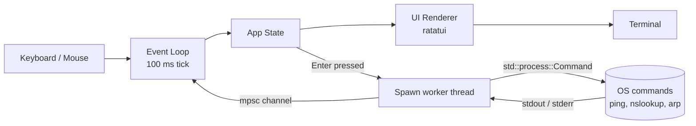
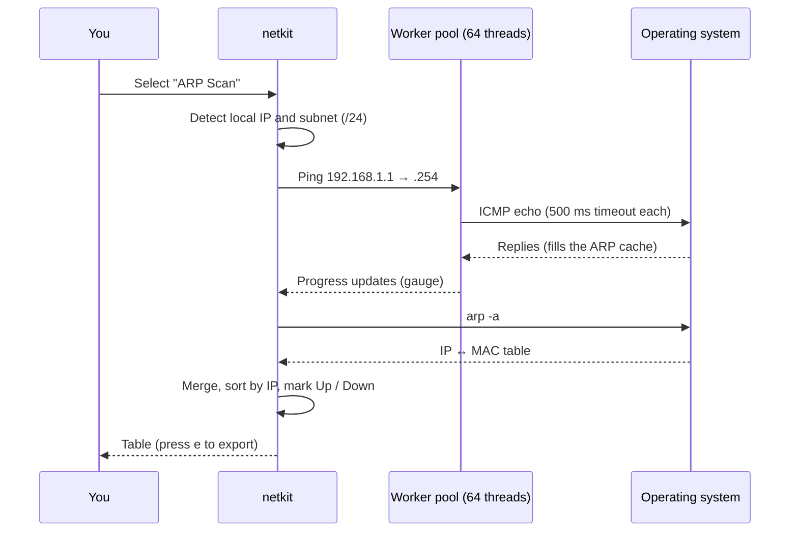

<div align="center">

# 🛰️ NetWin

### A fast, single-file network diagnostics toolkit for your terminal

Run `ipconfig`, `nslookup`, `ping` and subnet scans from **one keyboard-and-mouse driven interface**.
No installs. No dependencies. One ~2 MB binary.


<!-- Replace with a real screenshot or GIF (record with https://github.com/charmbracelet/vhs or ScreenToGif) -->


</div>

---

## 📖 Table of Contents

- [Why netkit?](#-why-netkit)
- [Features](#-features)
- [What it looks like](#-what-it-looks-like)
- [Install](#-install)
- [Usage and keybindings](#-usage-and-keybindings)
- [How it works](#-how-it-works)
- [Project structure](#-project-structure)
- [Build from source](#-build-from-source)
- [Limitations](#-limitations)
- [Roadmap](#-roadmap)
- [What I learned](#-what-i-learned)

---

## 🎯 Why netkit?

When a network problem is reported, first-line triage usually means:

```text
ipconfig /all   →   nslookup   →   ping   →   arp -a   →   copy results by hand
   window 1          window 2     window 3     window 4
```

Different windows, different syntax per OS, and results scattered everywhere.

**netkit puts it all in one place:**

| Before | With netkit |
|---|---|
| 4–5 separate commands | One interface |
| Different commands per OS (`ipconfig` / `ip addr` / `ifconfig`) | Same workflow everywhere |
| Manual copy and paste into tickets | Press `e` to export CSV |
| Install Python or tools first | Download one file and run it |

> netkit is **not** a replacement for Nmap or Wireshark. It is built for fast first-line triage and as a hands-on way to understand how these tools work underneath.

---

## ✨ Features

| | Feature | Description |
|---|---|---|
| 🩺 | **Diagnose** | IP configuration, DNS lookup, and ping with live output |
| 📡 | **Subnet scan** | Ping sweep plus ARP table, showing IP, MAC and status |
| 🎨 | **Themes** | Tokyo Night, Catppuccin Mocha, Gruvbox Dark (remembered between runs) |
| 🖱️ | **Mouse support** | Click menu items, scroll with the wheel |
| 📤 | **CSV export** | Save scan results with one key |
| ⚡ | **Non-blocking UI** | Commands run in background threads, with a spinner and timeout |
| 📦 | **Single binary** | No runtime, no dependencies, tiny footprint |

---

## 🖼️ What it looks like

```text
┌─ netkit ─────────────────────────────────────────────────────────────┐
│╭────────────────────╮╭─ Ping 8.8.8.8 ─────────────────── ⠹ 2s ─────╮│
││ ▸ DIAGNOSE         ││ Pinging 8.8.8.8 with 32 bytes of data:       ││
││     IP Config      ││ Reply from 8.8.8.8: bytes=32 time=14ms       ││
││   ▶ Ping           ││ Reply from 8.8.8.8: bytes=32 time=13ms       ││
││     DNS Lookup     ││ Reply from 8.8.8.8: bytes=32 time=15ms       ││
││                    ││ Reply from 8.8.8.8: bytes=32 time=13ms       ││
││ ▸ SCAN             ││                                              ││
││     ARP Scan       ││ Packets: Sent = 4, Received = 4, Lost = 0    ││
││                    ││                                              ││
││ ▸ CONFIGURE        ││                                              ││
││     Theme          ││                                              ││
│╰────────────────────╯╰──────────────────────────────────────────────╯│
│ ↑/↓ navigate  Enter run  j/k scroll  e export  q quit   Tokyo Night  │
└──────────────────────────────────────────────────────────────────────┘
```

**Scan results view:**

```text
╭─ ARP Scan  192.168.1.0/24 ───────────────────────────────────────────╮
│ Sweep  ████████████████████░░░░  83%                                 │
│                                                                      │
│  IP               MAC                 Status                         │
│  192.168.1.1      a4:2b:b0:1c:9e:10   ● Up     (green)               │
│  192.168.1.14     f8:ff:c2:55:03:7a   ● Up     (green)               │
│  192.168.1.23     3c:22:fb:90:11:c4   ● Up     (green)               │
│  192.168.1.40     --                  ● Down   (red)                 │
╰──────────────────────────────────────────────────────────────────────╯
```

> 📸 Replace these mockups with real screenshots in `docs/` once you have them.

---

## 📥 Install

**No Rust needed.** Pick whichever is easiest:

### Windows (PowerShell)

```powershell
irm https://raw.githubusercontent.com/<user>/<repo>/main/install.ps1 | iex
```

### Linux / macOS

```bash
curl -fsSL https://raw.githubusercontent.com/<user>/<repo>/main/install.sh | sh
```

### Manual download

1. Go to the [**Releases**](https://github.com/<user>/<repo>/releases) page
2. Download the file for your system
3. Unzip and run `netkit`

### With Rust (optional)

```bash
cargo install --git https://github.com/<user>/<repo>
```

Then just run:

```bash
netkit
```

---

## ⌨️ Usage and keybindings

```bash
netkit                     # launch
netkit --theme catppuccin  # start with a theme
netkit --no-mouse          # disable mouse capture
netkit --version
```

| Key | Action |
|---|---|
| `↑` / `↓` | Move through the menu |
| `Enter` | Run the selected item |
| `j` / `k`, `PgUp` / `PgDn` | Scroll output |
| `s` | Edit scan subnet (ARP Scan screen) |
| `a` | Toggle showing all hosts or only Up hosts |
| `e` | Export results to CSV |
| `t` / `c` / `g` | Theme: Tokyo Night / Catppuccin / Gruvbox |
| `Left click` | Select a menu item |
| `Mouse wheel` | Scroll output |
| `q` / `Ctrl+C` | Quit |

---

## 🧠 How it works

### Architecture



**Key idea:** the UI thread never waits on a command. Work happens in background threads and results come back through a channel, so the interface stays smooth while a scan runs.

### How the subnet scan works



**Why this works:** pinging a host forces your machine to learn its MAC address via ARP. Reading the ARP table afterwards maps each IP to a MAC. ARP only operates on the local Layer 2 segment, so scans work on your own subnet.

---

## 🗂️ Project structure

```text
netkit/
├── src/
│   ├── main.rs        # terminal setup/teardown, panic hook, event loop
│   ├── app.rs         # application state and navigation
│   ├── ui.rs          # all rendering (layout, tables, gauge, status bar)
│   ├── theme.rs       # Tokyo Night, Catppuccin, Gruvbox palettes
│   ├── commands.rs    # OS-specific command execution (cfg windows / unix)
│   └── scan.rs        # ping sweep, ARP parsing, CSV export
├── .github/workflows/
│   └── release.yml    # builds binaries for every OS on tag push
├── install.ps1        # Windows one-line installer
├── install.sh         # Linux / macOS one-line installer
├── tutorial.md        # step-by-step walkthrough of the code
└── Cargo.toml
```

---

## 🔨 Build from source

```bash
git clone https://github.com/<user>/<repo>.git
cd <repo>
cargo build --release
```

The binary is created at `target/release/netkit` (or `netkit.exe` on Windows).

The release profile is tuned for a tiny single-file result:

```toml
[profile.release]
opt-level = "z"      # optimize for size
lto = true           # link-time optimization
codegen-units = 1
panic = "abort"
strip = true         # remove debug symbols
```

---

## ⚠️ Limitations

Being upfront about what netkit does **not** do:

- Relies on built-in OS commands, so output depends on the OS
- Hosts that block ICMP may appear as **Down** even though they are online
- Scans IPv4 `/24` by default (editable with `s`)
- ARP scanning may need **administrator / root** rights on some systems
- No packet capture (use Wireshark for that)

---

## 🗺️ Roadmap

- [ ] Traceroute
- [ ] Port scanner
- [ ] DNS record types (A, MX, TXT, NS)
- [ ] Live bandwidth monitor
- [ ] Wi-Fi signal and channel info
- [ ] IPv6 support

---

## 📚 What I learned

Building netkit was a hands-on way to understand:

- **Networking:** subnetting and CIDR, ICMP, ARP, DNS, and the difference between Layer 2 and Layer 3
- **Concurrency:** threads, channels, and bounded worker pools
- **Systems programming:** process spawning, timeouts, and cross-platform code with `cfg`
- **Shipping software:** static linking, release profiles, and CI release pipelines

See [`tutorial.md`](tutorial.md) for a full walkthrough of the code.

---

## 📄 License

MIT. See [LICENSE](LICENSE).

<div align="center">

**Built by [Khushwant Singh](https://github.com/<user>)**

</div>
